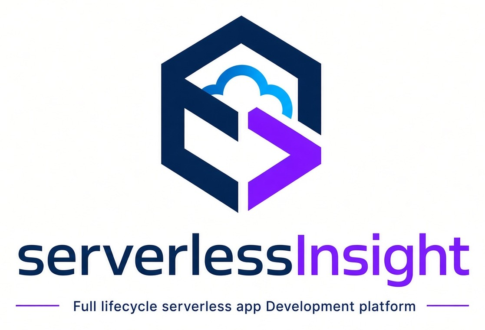

<div align="center">



# Serverless-Adapter

**让你的 Express、Koa、Hono 应用跑在任何 Serverless 平台上 —— 无需重写。**

**一份代码。多云部署。自动识别云厂商。**

**Express · Koa · Hono —— 阿里云 FC · 腾讯云 SCF · 火山引擎 veFaaS · AWS Lambda · Cloudflare Workers。**

[](https://github.com/geek-fun/serverless-adapter/releases)
[](https://www.npmjs.com/package/@geek-fun/serverless-adapter)
[](https://www.npmjs.com/package/@geek-fun/serverless-adapter)
[](https://github.com/geek-fun/serverless-adapter/actions/workflows/node.yml)
[](https://codecov.io/gh/geek-fun/serverless-adapter)
[](https://snyk.io/test/github/geek-fun/serverless-adapter)
[](LICENSE)
[](https://github.com/geek-fun/serverless-adapter/stargazers)

<p>
  
  
  
  
  
</p>
<p>
  
  
  
  
  
</p>

[npm](https://www.npmjs.com/package/@geek-fun/serverless-adapter) · [发布](https://github.com/geek-fun/serverless-adapter/releases) · [Issues](https://github.com/geek-fun/serverless-adapter/issues)

简体中文 · [English](README.md)

</div>

---

Serverless-Adapter 是一个轻量的适配层，让 **Express**、**Koa** 和 **Hono** 应用可以直接运行在五家云厂商的 Serverless 平台上。你的应用代码无需任何改动：适配器负责把各平台的调用事件翻译成框架请求，再把框架响应翻译回平台的响应格式 —— 并且支持**自动识别云厂商**，同一个 handler 无需修改即可跨云部署。

## 目录

- [核心特性](#核心特性)
- [支持的云服务商](#支持的云服务商)
- [支持的框架](#支持的框架)
- [快速开始](#快速开始)
- [API 参考](#api-参考)
- [定时器与非 HTTP 触发器](#定时器与非-http-触发器)
- [云厂商识别](#云厂商识别)
- [参与贡献](#参与贡献)
- [相关项目](#相关项目)

## 核心特性

- **多云支持，一份代码** —— 同一个应用可以部署到阿里云函数计算、腾讯云 SCF、火山引擎 veFaaS、AWS Lambda 和 Cloudflare Workers，无需为每个云编写胶水代码。
- **自动识别云厂商** —— 适配器通过检查调用上下文自动路由到对应的云厂商，需要时也可以显式指定。
- **正确处理定时器与非 HTTP 触发器** —— 提供跨云厂商统一的 `TimerEvent` 标准化事件结构，采用保守的事件分类策略，未匹配的非 HTTP 调用会显式失败，而不是被静默吞掉。
- **框架无关** —— 支持 Express 4/5、Koa 2/3 和 Hono 4；你的路由、中间件和处理器代码完全不用改。
- **TypeScript 优先** —— 完整的类型推导；一旦配置了非 HTTP 事件，handler 的返回值类型会自动收窄（`ServerlessHandler<Result>`）。
- **轻量** —— 仅有两个运行时依赖（`debug`、`raw-body`）。

## 支持的云服务商

| 云服务商       | 服务                            | 状态    | 触发类型                                |
| -------------- | ------------------------------- | ------- | --------------------------------------- |
| 阿里云         | 函数计算（Function Compute）    | ✅ 支持 | API 网关                                |
| 腾讯云         | 云函数（SCF）                   | ✅ 支持 | 函数 URL                                |
| 火山引擎       | veFaaS（函数服务）              | ✅ 支持 | API 网关                                |
| AWS            | Lambda + API Gateway            | ✅ 支持 | API 网关（REST API v1 & HTTP API v2）   |
| Cloudflare     | Workers                         | ✅ 支持 | fetch（Request → Response）             |

> **注意**：腾讯云已下线 SCF API 网关触发器（服务于 2025-06-30 停止）；本适配器支持的是函数 URL（Function URL）的事件函数格式。Web 函数（Web functions，在 9000 端口直接监听 HTTP）模式无需适配器，不在本项目范围内。

## 支持的框架

| 框架    | 版本 | 状态    |
| ------- | ---- | ------- |
| Express | 4.x  | ✅ 支持 |
| Express | 5.x  | ✅ 支持 |
| Koa     | 2.x  | ✅ 支持 |
| Koa     | 3.x  | ✅ 支持 |
| Hono    | 4.x  | ✅ 支持 |

> **注意**：Hono 支持要求 Node.js >= 18（需要 Web API 的 Request/Response 全局对象）。
> Express 和 Koa 继续支持 Node.js >= 16。

## 快速开始

### 前置条件

- Node.js >= 16.x

### 安装

```bash
npm install @geek-fun/serverless-adapter
```

### 用法

#### 自动识别云厂商（推荐）

适配器会根据上下文对象自动识别云厂商：

```typescript
import express from 'express';
import serverlessAdapter from '@geek-fun/serverless-adapter';

const app = express();

app.get('/', (req, res) => {
  res.json({ message: 'Hello World!' });
});

// 根据上下文自动识别云厂商
export const handler = serverlessAdapter(app);
```

#### 显式指定云厂商

也可以显式指定云厂商：

```typescript
import express from 'express';
import serverlessAdapter from '@geek-fun/serverless-adapter';

const app = express();

app.get('/', (req, res) => {
  res.json({ message: 'Hello from Tencent Cloud!' });
});

// 显式指定腾讯云
export const main_handler = serverlessAdapter(app, { provider: 'tencent' });
```

#### 阿里云函数计算示例

```typescript
import express from 'express';
import serverlessAdapter from '@geek-fun/serverless-adapter';

const app = express();

app.get('/api/users', (req, res) => {
  res.json({ users: [] });
});

// 阿里云函数计算的 handler
export const handler = serverlessAdapter(app);
```

#### 腾讯云 SCF 示例

```typescript
import express from 'express';
import serverlessAdapter from '@geek-fun/serverless-adapter';

const app = express();

app.get('/api/users', (req, res) => {
  res.json({ users: [] });
});

// 腾讯云 SCF 的 handler
export const main_handler = serverlessAdapter(app, { provider: 'tencent' });
```

#### 火山引擎 veFaaS 示例

```typescript
import express from 'express';
import serverlessAdapter from '@geek-fun/serverless-adapter';

const app = express();

app.get('/api/users', (req, res) => {
  res.json({ users: [] });
});

// 火山引擎 veFaaS 的 handler
export const handler = serverlessAdapter(app, { provider: 'volcengine' });
```

#### Cloudflare Workers 示例

```typescript
import express from 'express';
import serverlessAdapter from '@geek-fun/serverless-adapter';

const app = express();

app.get('/api/users', (req, res) => {
  res.json({ users: [] });
});

const handler = serverlessAdapter(app, { provider: 'cloudflare' });

export default {
  async fetch(request: Request, context: ExecutionContext): Promise<Response> {
    const result = await handler(request, context);
    const headers = new Headers(result.headers as Record<string, string>);
    (result.multiValueHeaders ?? {}).setCookie?.forEach((cookie) => headers.append('set-cookie', cookie));

    const body = result.isBase64Encoded
      ? Buffer.from(result.body, 'base64')
      : result.body;

    return new Response(body, { status: result.statusCode, headers });
  },
};
```

#### Hono 示例

```typescript
import { Hono } from 'hono';
import serverlessAdapter from '@geek-fun/serverless-adapter';

const app = new Hono();

app.get('/', (c) => c.json({ message: 'Hello from Hono!' }));

// 根据上下文自动识别云厂商
export const handler = serverlessAdapter(app);
```

## API 参考

### `serverlessAdapter(app, options?)`

为你的 Express、Koa 或 Hono 应用创建一个 Serverless handler。这种位置参数形式是纯 HTTP 应用的标准写法。

#### 参数

| 参数                       | 类型                                                             | 必填 | 说明                                                                                                                                                                                         |
| -------------------------- | ---------------------------------------------------------------- | ---- | -------------------------------------------------------------------------------------------------------------------------------------------------------------------------------------------- |
| `app`                      | `Express \| Koa \| Hono`                                         | 是   | Express、Koa 或 Hono 应用实例                                                                                                                                                                |
| `options.provider`         | `'aliyun' \| 'tencent' \| 'volcengine' \| 'aws' \| 'cloudflare'` | 否   | 显式指定云厂商（省略时自动识别）                                                                                                                                                              |
| `options.events`           | `{ timer?, nonHttp? }`                                           | 否   | 非 HTTP 触发器的处理器，按事件类型注册 —— 见[定时器与非 HTTP 触发器](#定时器与非-http-触发器)                                                                                                  |
| `options.onUnhandledEvent` | `'error' \| 'ignore'`                                            | 否   | 当非 HTTP 调用没有匹配的 `events` 处理器时的行为。默认为 `'error'`（抛出异常）；`'ignore'` 恢复历史宽松行为 —— 见[定时器与非 HTTP 触发器](#定时器与非-http-触发器)                              |

#### 返回值

返回一个处理 Serverless 事件的函数，其返回值类型如下：

```typescript
// 纯 HTTP 形式（位置参数传入 app、未配置 `events`）：HTTP 响应结构
(event: Buffer, context: ProviderContext) =>
  Promise<{
    statusCode: number;
    body: string;
    headers: Record<string, string>;
    isBase64Encoded: boolean;
  }>;

// 配置了 `events` 处理器的任何形式：调用可能是定时器 / 队列事件，
// 返回值就是对应处理器返回的内容 —— `ServerlessHandler<unknown>`
(event: Buffer, context: ProviderContext) => Promise<unknown>;
```

HTTP 调用返回 HTTP 响应结构；定时器 / 非 HTTP 调用的返回值就是对应 `events` 处理器的返回值，原样透传。类型定义与该行为完全一致：一旦配置了 `events` 处理器，handler 的类型就是 `ServerlessHandler<unknown>`，编译器不会假装定时器的返回值是 HTTP 响应结构。`ServerlessHandler<Result>` 和 `ServerlessHandlerResult` 已导出，可用于标注你自己的代码。

### `serverlessAdapter({ provider, events: { http, timer } })`（对称形式）

对于多触发器函数，HTTP 应用可以声明在 `events` 里，与其他处理器并列。两种形式都支持 —— 第一个参数很容易区分（Express 应用是函数，Koa 暴露 `.callback`，Hono 暴露 `.fetch`，而 options 对象三者皆无）：

```typescript
// 纯 HTTP 应用 —— 标准形式，保持不变
serverlessAdapter(app, { provider: 'volcengine' });

// 多触发器函数（HTTP + 定时器）—— 形式统一，此场景下推荐
serverlessAdapter({
  provider: 'volcengine',
  events: { http: app, timer: runTimerJob },
});
```

对称形式接受相同的 `provider` / `onUnhandledEvent` 选项；纯 HTTP 应用仍然以位置参数形式为标准写法。

## 定时器与非 HTTP 触发器

在阿里云 FC、腾讯云 SCF、火山引擎 veFaaS 和 AWS Lambda 上，**一个函数只有一个 handler，所有触发器类型都以不同的事件结构投递给它**。因此定时触发器、队列事件或对象存储通知会和 HTTP 请求一样到达同一个 handler —— 但它既没有可构建的请求，也不需要满足 HTTP 响应契约。

把这类调用分发进 Web 框架，等于响应了一个不存在的请求，而且平台会把这次调用记录为**成功**：本该运行的定时任务就这样被静默吞掉了。因此适配器会在标准化之前对每次调用进行分类。注册了 `events` 处理器时，非 HTTP 调用会被路由过去；没有匹配的处理器时，调用会显式失败：

```typescript
const http = serverlessAdapter(app);

export const handler = (event, context) => http(event, context);
// 定时触发器会让这次调用 reject：
//   UnsupportedEventError: Unsupported timer invocation for provider "aliyun"
//   (trigger "billing-run"): this adapter only handles HTTP events. Handle
//   non-HTTP triggers in your own entrypoint, or pass
//   { onUnhandledEvent: 'ignore' } to keep the previous behaviour.
//   Event keys: triggerTime, triggerName, payload.
```

### 用 `events.timer` 处理定时器

注册一个 `events.timer` 处理器，适配器会把每个被明确识别为定时器的调用标准化成跨云厂商统一的 `TimerEvent`：

```typescript
import serverlessAdapter from '@geek-fun/serverless-adapter';

const runTimerJob = async (event: TimerEvent) => {
  console.log(`timer ${event.triggerName} fired at ${event.triggerTime}`);
  if (event.payload?.job === 'billing-run') {
    await runBillingRun();
  }
  // 返回值会原样透传给平台 ——
  // 永远不会被包装成伪造的 statusCode/body
};

export const handler = serverlessAdapter(app, {
  provider: 'aliyun',
  events: {
    timer: runTimerJob,
    // 被明确识别为非 HTTP 但不是定时器的事件
    //（队列事件、对象存储通知等）
    nonHttp: (raw, context) => handleOtherTrigger(raw, context),
  },
});
```

标准化后的事件结构在各云厂商之间完全一致：

```typescript
export type TimerEvent = {
  provider: CloudProvider; // 仅供日志/遥测参考，绝不作为分发键
  triggerName?: string;
  triggerTime?: string;
  payload?: unknown;       // 可解析为 JSON 时解析，否则为原始字符串
  raw: unknown;            // 平台原始事件 —— 永远不丢失信息
};
```

也可以使用对称形式，它与部署结构读起来完全一致：

```typescript
export const handler = serverlessAdapter({
  provider: 'aliyun',
  events: { http: app, timer: runTimerJob },
});
```

注意：

- `events.timer` / `events.nonHttp` 内部抛出的异常会向上传播并导致调用失败 —— 永远不会被转换成 `500` HTTP 响应。
- `onUnhandledEvent` 只约束**没有**匹配处理器的调用：`'error'`（默认）抛出 `UnsupportedEventError`；`'ignore'` 恢复历史宽松分发。显式注册的处理器永远优先。

| 调用类型                          | 有匹配的 `events` 处理器     | 默认（`'error'`）                 | `'ignore'`           |
| --------------------------------- | ---------------------------- | --------------------------------- | -------------------- |
| HTTP 事件                         | 由框架处理                   | 由框架处理                        | 由框架处理           |
| 定时器事件                        | `events.timer`（已标准化）   | `UnsupportedEventError` —— 调用失败 | 照常分发（历史行为） |
| 被识别出的其他非 HTTP 事件        | —                            | `UnsupportedEventError` —— 调用失败 | 照常分发（历史行为） |
| 无法识别的事件                    | `events.nonHttp`（原始事件） | `UnsupportedEventError` —— 调用失败 | 照常分发（历史行为） |

让调用失败很重要：只有 handler 抛出异常时，FC / SCF / Lambda 才会把调用标记为失败，这样才能进入日志、告警和平台的重试策略。`onUnhandledEvent: 'ignore'` 只是给依赖旧宽松行为的代码提供的废弃过渡选项。

各云厂商可识别的定时器事件：

| 云厂商            | 可识别的定时器事件结构                                                                          | 说明                                                                                                                                                                                                                    |
| ----------------- | ----------------------------------------------------------------------------------------------- | ----------------------------------------------------------------------------------------------------------------------------------------------------------------------------------------------------------------------- |
| 阿里云 FC3        | `{triggerTime, triggerName, payload}`                                                           | 以 Buffer 投递；也接受普通对象（如 `si local`）                                                                                                                                                                          |
| 腾讯云 SCF        | `{Type: 'Timer', TriggerName, Time, Message}`                                                    | —                                                                                                                                                                                                                       |
| 火山引擎 veFaaS   | CloudEvents `{id, source: '/faas/event/timer/{timer_id}', type: 'faas.timer.event', time, data}` | `triggerName` 从 `source` 解析出的定时器 id（事件本身不带触发器名），`triggerTime` 为 `time`，`payload` 为 `data`。`si local` 发出的 SCF 风格结构仍然可用。TOS / MQ / TLS 的 CloudEvents 视为 `unknown`，进入 `events.nonHttp` |
| AWS               | `{version, id, 'detail-type': 'Scheduled Event', source: 'aws.events', resources: [rule ARN]}`   | `resources[0]` 中的规则名作为 `triggerName`（兜底用 `id`），`detail` 作为 `payload`。EventBridge **Scheduler** 携带自定义输入调用函数时，与手写事件无法区分；会被报告为 `unknown` 并进入 `events.nonHttp`                  |
| Cloudflare        | —                                                                                               | Cron Triggers 投递给 Worker 独立的 `scheduled()` 导出，适配器看不到它 —— 见 [Cloudflare 边界](#cloudflare-边界)                                                                                                           |

各云厂商可识别的 HTTP 事件：

| 云厂商            | HTTP 字段                                                                                                                                                               |
| ----------------- | ------------------------------------------------------------------------------------------------------------------------------------------------------------------------ |
| 阿里云 FC3 / AWS  | API 网关结构：`path` / `rawPath` / `httpMethod`（v1），`version: '2.0'` + `rawPath`（v2），ALB（`requestContext.elb` + `httpMethod`）                                     |
| 腾讯云 SCF        | 函数 URL（`httpMethod`，`path` 可选）以及旧版 API 网关结构（`queryStringParameters` / `requestContext`）                                                                   |
| 火山引擎 veFaaS   | 文档定义的 API 网关结构：`path` + `httpMethod` + `queryStringParameters` + `pathParameters`；旧版 `method` / `query` 写法仍然可用                                          |

### Cloudflare 边界

Cloudflare Workers 在运行时层面就分离了不同入口：`fetch` 和 `scheduled` 是两个独立的导出，适配器无法拦截。请在 Worker 入口自行组合：

```typescript
import serverlessAdapter from '@geek-fun/serverless-adapter';

const handler = serverlessAdapter(app);

export default {
  fetch: (request, env, ctx) => handler(request, ctx),
  scheduled: (controller, env, ctx) => runTimerJob({ /* 自定义结构 */ }),
};
```

### 保留自己的入口（手动方案）

如果你更愿意在自己的入口里做事件分类，而不是注册 `events` 处理器，标准化函数也支持导出复用：

```typescript
import serverlessAdapter, { isTimerEvent, normalizeTimerEvent } from '@geek-fun/serverless-adapter';

const http = serverlessAdapter(app, { provider: 'aliyun' });

export const handler = async (event, context) => {
  // 传入你的部署目标云厂商：不传的话，两个辅助函数会扫描
  // 所有云厂商的标记，并把事件归给第一个命中的厂商。
  const timer = normalizeTimerEvent(event, 'aliyun');

  if (timer?.triggerName === 'billing-run') {
    return runBillingRun(timer);
  }

  if (isTimerEvent(event, 'aliyun')) {
    return someOtherTimer(event); // 是定时器，但不是本函数要处理的
  }

  return http(event, context);
};
```

分类策略是保守的：只有事件明确匹配已知 HTTP 结构才算 `http`，只有明确匹配定时器事件结构才算 `timer`，其余一律 `unknown`。绝不猜测。

## 云厂商识别

适配器通过检查 `context` 对象自动识别云厂商：

| 云厂商     | 识别字段                                                 |
| ---------- | -------------------------------------------------------- |
| 阿里云     | `service.name`, `tracing`, `logger`, `function.memory`   |
| 腾讯云     | `tencentcloud_region`, `tencentcloud_appid`, `namespace` |
| 火山引擎   | `requestId`, `region`, `function.memoryMb`               |
| AWS        | `awsRequestId`, `invokedFunctionArn`, `functionName`     |
| Cloudflare | web `Request` 事件 + context 上的 `waitUntil`            |

## 参与贡献

欢迎参与贡献！本地开发流程：

```bash
git clone https://github.com/geek-fun/serverless-adapter.git
cd serverless-adapter
npm install
npm test           # 运行 Jest 并统计覆盖率 —— 强制 85% 的各项覆盖率阈值
npm run lint:check # ESLint + Prettier
npm run build      # TypeScript 构建
```

新增代码或修复 bug 时请附带测试 —— `jest.config.cjs` 中的覆盖率门槛（语句 / 分支 / 函数 / 行均为 85%）必须持续通过。较大的改动请先开 issue，便于我们对齐设计。

## 相关项目

- [ServerlessInsight](https://github.com/geek-fun/serverlessinsight) —— 用 YAML 定义 Serverless 基础设施，跨阿里云、腾讯云、华为云和火山引擎部署。可以与本适配器搭配使用：ServerlessInsight 负责创建函数和网关，本适配器让你的框架应用跑在上面。

## 许可证

[Apache-2.0](LICENSE)

---

<div align="center">

简体中文 · [English](README.md)

</div>
